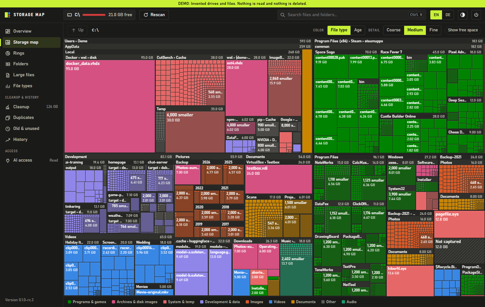
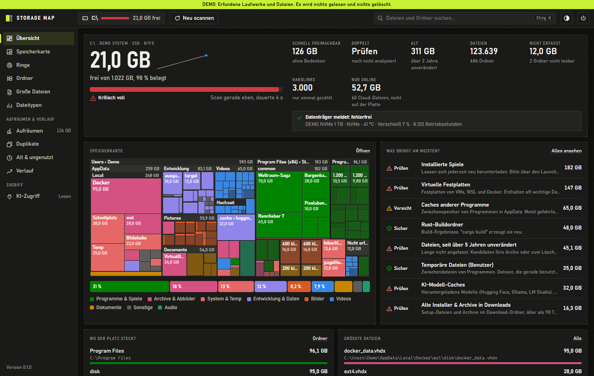

# Storage Map

[](https://github.com/codeflag/storage-map/actions/workflows/ci.yml)
[](https://github.com/codeflag/storage-map/releases/latest)
[](https://github.com/codeflag/storage-map/releases)
[](LICENSE)
[](#herunterladen)
[](CONTRIBUTING.md)
[](docs/mcp.md)

[English version](README.md)

Storage Map zeigt, womit ein Laufwerk gefüllt ist, und hilft beim Aufräumen. Es läuft unter Windows und Linux als einzelnes Programm und braucht keine Installation.



*Alle Bilder stammen aus der eingebauten Demo mit erfundenen Dateien.*

## Herunterladen

Die aktuelle Version liegt auf der [Release-Seite](https://github.com/codeflag/storage-map/releases).

| System | Datei |
|---|---|
| Windows 10/11, x86-64 | `storage-map-VERSION-windows-x86_64.zip` |
| Linux, x86-64 | `storage-map-VERSION-linux-x86_64.tar.gz`, `.deb` oder `.rpm` |
| Linux, ARM64 | `storage-map-VERSION-linux-aarch64.tar.gz`, `.deb` oder `.rpm` |

Unter Windows heißt das Programm `StorageMap.exe`, unter Linux `storage-map`. Befehle in dieser Anleitung nutzen den Linux-Namen.

Die Linux-Fassungen sind statisch gelinkt und laufen auf jeder Distribution. `SHA256SUMS` enthält die Prüfsummen aller Dateien.

Die Windows-Fassung ist nicht signiert, SmartScreen kann deshalb beim ersten Start warnen. Für das eigene Fenster braucht das Programm Edge, Chrome oder einen anderen Chromium-Browser. Ohne einen davon öffnet es sich im Standardbrowser.

## Starten

`StorageMap.exe` oder `storage-map` starten, Laufwerk wählen und **Scannen** klicken. Der Scan liest Namen, Größen und Datumsangaben. Dateien selbst werden nur bei der Duplikat-Suche gelesen, und entfernt wird nur, was du bestätigst.

## Ansichten



| Ansicht | Wofür |
|---|---|
| **Übersicht** | Belegung, Zustand des Datenträgers, Aufräum-Potenzial, größte Ordner und Dateien, Alter und Größen |
| **Speicherkarte** | Jede Fläche ist so groß wie der belegte Platz. Färbung nach Dateityp oder Alter, Zoom per Doppelklick oder Mausrad |
| **Ringe** | Dieselben Daten radial: zeigt gut, wie Platz verschachtelt ist |
| **Ordner** | Aufklappbarer Baum mit Anteilsbalken. „Größtem Pfad folgen“ führt direkt zum Hauptverursacher |
| **Große Dateien** | Sortierbare Liste mit Filtern nach Typ, Größe, Alter und Suche, dazu CSV-Export |
| **Dateitypen** | Kategorien und Endungen. Ein Klick führt zu den Dateien |
| **Aufräumen** | Feste Regeln mit Begründung und Risikostufe: Temp, Caches, Build-Ordner, alte Installer, Logs und mehr |
| **Duplikate** | Vergleich in Stufen bis zum kompletten Inhalt, dazu doppelte Ordner |
| **Alt & ungenutzt** | Lange unveränderte Dateien und vergessene Ordner |
| **Verlauf** | Entwicklung über mehrere Scans, Prognose bis „voll“ und was seit dem letzten Scan gewachsen ist |
| **KI-Zugriff** | Rechte und Protokoll des MCP-Servers |

Tastatur: `1` bis `9` wechselt die Ansicht, `Strg+K` sucht, `Entf` setzt die Auswahl auf die Aufräumliste, `Rücktaste` geht in der Karte eine Ebene hoch. In der Suche filtert `*.mp4` nach Endung, ein Wort mit `/` sucht im ganzen Pfad.

## Dateien entfernen

- Alles kommt zuerst auf die **Aufräumliste**. Dort prüfst du und entscheidest: Papierkorb, verschieben oder endgültig löschen.
- Endgültiges Löschen muss mit einem getippten Wort bestätigt werden.
- Systemordner, Startdateien, Auslagerungsdateien und Profil-Stammordner sind gesperrt. Das prüft das Programm vor jedem Entfernen, nicht nur die Oberfläche.
- Direkt vor dem Entfernen wird jede Datei erneut geprüft. Hat sie sich seit dem Scan geändert, bleibt sie liegen.
- Netzlaufwerke haben keinen Papierkorb. Das Programm sagt das und bietet dort nur Verschieben oder endgültiges Löschen an.
- Der Platz im Papierkorb wird erst frei, wenn er geleert wird.

## MCP-Server

Mit `storage-map --mcp` stehen die Auswertungen KI-Clients wie Claude Desktop, Claude Code oder Cursor über das [Model Context Protocol](https://modelcontextprotocol.io) zur Verfügung. Standard ist Lesen. Schreiben und Löschen müssen in der Ansicht **KI-Zugriff** freigegeben werden, jeweils nach einer Warnung, die bestätigt werden muss.

Datei- und Ordnernamen gehen an den KI-Client und meist weiter an dessen Anbieter, Dateiinhalte nie. Einrichtung, Werkzeuge und Sicherheitsmodell stehen in [docs/mcp.md](docs/mcp.md).

## Kommandozeile

```bash
storage-map --help
```

`storage-map --scan PFAD` scannt ohne Fenster und schreibt in den Verlauf. In der Aufgabenplanung oder in cron eingetragen, entsteht so von selbst ein Verlauf. Den passenden Befehl zeigt die Ansicht **Verlauf**.

## Wo die Daten liegen

| | Windows | Linux |
|---|---|---|
| Scans und Verlauf | `%LOCALAPPDATA%\StorageMap` | `~/.local/share/storage-map` |
| Einstellungen | `%LOCALAPPDATA%\StorageMap\config.json` | `~/.config/storage-map/config.json` |

Storage Map baut keine Netzwerkverbindungen auf, außer zu sich selbst auf `127.0.0.1`. Der lokale Server verlangt ein zufälliges Token, fremde Webseiten kommen deshalb nicht an ihn heran. Pro Laufwerk liegen dort der letzte Scan und bis zu 40 kompakte Ordnerlisten. Wenn du den Ordner löschst, gehen nur der Verlauf und die gespeicherten Scans verloren.

## Ohne echte Laufwerke ausprobieren

```bash
storage-map --demo
```

Erfundene Laufwerke im Speicher. Es wird keine Nutzerdatei gelesen und nichts gelöscht. Ein Banner weist darauf hin.

```bash
storage-map --make-fixture /tmp/fixture
storage-map --sandbox /tmp/fixture
```

Legt einen Testordner mit bekanntem Inhalt an (etwa 80 MB) und prüft damit den echten Scan, das Hashen und das Entfernen. Alles außerhalb des Ordners wird abgelehnt.

## Bauen und Lizenz

Voraussetzung ist Rust. Die Version steht in `rust-toolchain.toml`, `rustup` richtet sich danach.

```bash
cargo build --release
```

Lizenz: [MIT](LICENSE).
