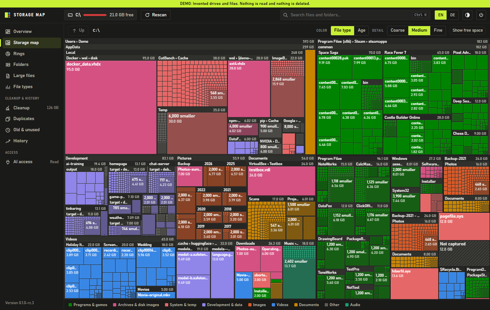
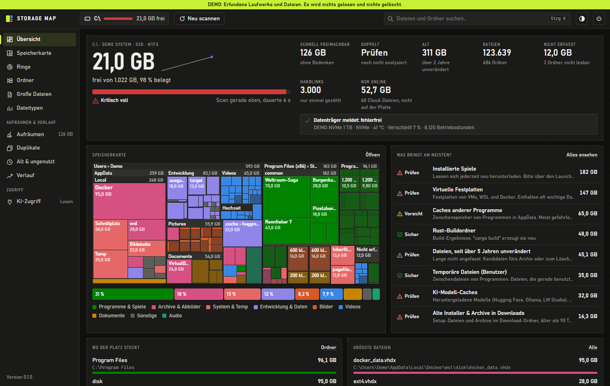
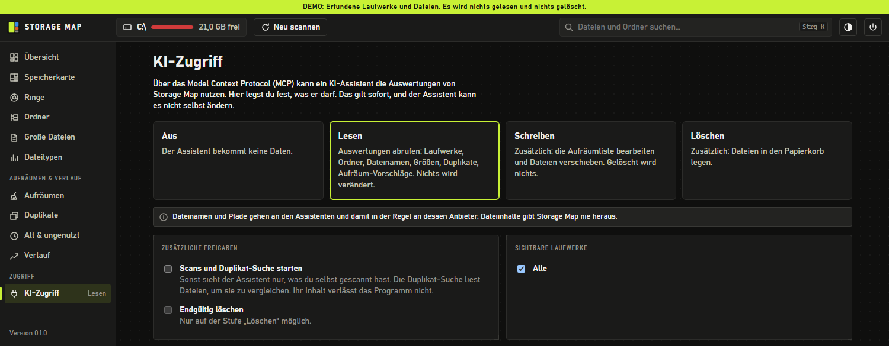

# Storage Map

[](https://github.com/codeflag/storage-map/actions/workflows/ci.yml)
[](https://github.com/codeflag/storage-map/releases/latest)
[](https://github.com/codeflag/storage-map/releases)
[](LICENSE)
[](#download)
[](CONTRIBUTING.md)
[](docs/mcp.md)

[Deutsche Version](README.de.md)

Storage Map shows what fills a drive and helps you clean it up. It runs on Windows and Linux as a single program and needs no installation.



*All screenshots use the built-in demo with invented files.*

The user interface is in German so far. The MCP interface and the command line are in English.

## Download

Get the latest version from the [releases page](https://github.com/codeflag/storage-map/releases).

| System | File |
|---|---|
| Windows 10/11, x86-64 | `storage-map-VERSION-windows-x86_64.zip` |
| Linux, x86-64 | `storage-map-VERSION-linux-x86_64.tar.gz`, `.deb` or `.rpm` |
| Linux, ARM64 | `storage-map-VERSION-linux-aarch64.tar.gz`, `.deb` or `.rpm` |

The Linux builds are statically linked and work on any distribution. `SHA256SUMS` lists the checksums of all files.

Windows builds are not code-signed, so SmartScreen may warn on first start. The window needs Edge, Chrome or another Chromium browser. Without one, Storage Map opens in your default browser.

## Start

Run `storage-map`, pick a drive and click **Scannen**. The scan reads names, sizes and dates. Files are only read during a duplicate search, and nothing is removed until you confirm it.

## Views



| View | Purpose |
|---|---|
| **Übersicht** | Usage, drive health, cleanup potential, largest folders and files, age and size distribution |
| **Speicherkarte** | Treemap: each area is as large as the space it takes. Colored by file type or age, zoom by double-click or mouse wheel |
| **Ringe** | The same data as a sunburst, which shows nesting well |
| **Ordner** | Expandable tree with size bars. "Größtem Pfad folgen" leads straight to the main cause |
| **Große Dateien** | Sortable list with filters for type, size, age and search, plus CSV export |
| **Dateitypen** | Categories and extensions, one click leads to the files |
| **Aufräumen** | Fixed rules with a reason and a risk level: temp files, caches, build folders, old installers, logs and more |
| **Duplikate** | Compares size, then start and end, then full content. Also finds duplicate folders |
| **Alt & ungenutzt** | Files unchanged for a long time and forgotten folders |
| **Verlauf** | Usage across scans, a forecast of when the drive is full, and what grew since the last scan |
| **KI-Zugriff** | Permissions and log of the MCP server |

Keyboard: `1` to `9` switch views, `Ctrl+K` searches, `Del` puts the selection on the cleanup list, `Backspace` goes up in the treemap. In the search, `*.mp4` filters by extension and a word containing `/` searches the whole path.

## Removing files

- Everything first goes on the **cleanup list**. There you review it and choose: recycle bin, move, or delete permanently.
- Permanent deletion must be confirmed by typing a word.
- System folders, boot files, swap files and profile root folders are locked. The program checks this before every removal, not just in the interface.
- Every file is checked again right before removal. If it changed since the scan, it stays.
- Network drives have no recycle bin. The program says so and offers only moving or permanent deletion.
- Space in the recycle bin becomes free only when the bin is emptied.

## MCP server

`storage-map --mcp` makes the results available to AI clients such as Claude Desktop, Claude Code or Cursor over the [Model Context Protocol](https://modelcontextprotocol.io). The default is read-only. Writing and deleting must be enabled in the **KI-Zugriff** view, each with a warning that has to be confirmed.

File and folder names go to the AI client and usually on to its provider. File contents never do. See [docs/mcp.md](docs/mcp.md) for setup, tools and the security model.



## Command line

```bash
storage-map --help
```

`storage-map --scan PATH` scans without a window and adds the result to the history. Run from the Windows Task Scheduler or cron, it builds up a history on its own. The **Verlauf** view shows the matching command.

## Where data is stored

| | Windows | Linux |
|---|---|---|
| Scans and history | `%LOCALAPPDATA%\StorageMap` | `~/.local/share/storage-map` |
| Settings | `%LOCALAPPDATA%\StorageMap\config.json` | `~/.config/storage-map/config.json` |

Storage Map makes no network connections except to itself on `127.0.0.1`. The local server requires a random token, so other websites cannot reach it. For each drive, the last scan and up to 40 compact folder lists are kept. Deleting the folder only loses the history and saved scans.

## Differences between Windows and Linux

| | Windows | Linux |
|---|---|---|
| Scan | One drive letter, including junctions as links | One file system. Other mounted file systems are shown but not entered |
| Recycle bin | Windows recycle bin | [freedesktop trash](https://specifications.freedesktop.org/trash-spec/latest/), as used by GNOME, KDE and others |
| More access | Restart as administrator from the program | Start with `sudo` |
| Drive health | Windows storage API | Model from `/sys`, health from `smartctl` if installed and permitted |
| "Created" date | Always available | Not available in the static builds |
| "Last opened" date | Unreliable by default on Windows, the program says so | Depends on mount options, unavailable with `noatime` |

## Trying it without real drives

```bash
storage-map --demo
```

Invented drives held in memory. No user file is read and nothing is deleted. A banner points this out. `--demo-scale 14` does the same with over a million files.

```bash
storage-map --make-fixture /tmp/fixture
storage-map --sandbox /tmp/fixture
```

Creates a test folder with known contents (about 80 MB) and exercises the real scan, hashing and removal. Everything outside the folder is refused, and the recycle bin and file manager are simulated.

## Building

Requires Rust. The version is pinned in `rust-toolchain.toml`, which `rustup` follows automatically.

```bash
cargo build --release
```

```bash
cargo test
```

See [CONTRIBUTING.md](CONTRIBUTING.md) for how the code is organized and how to test it.

## License

[MIT](LICENSE). Licenses of the libraries used are listed in `THIRD_PARTY_LICENSES.md` in each release.
